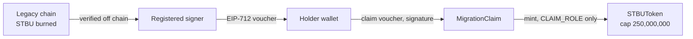

# STBU on Base: contracts

Solidity sources of the canonical Stobox Token (STBU) on [Base](https://base.org) and of the migration claim contract that mints it. For holders, integrators and anyone who wants to read what the deployed contracts do.


## Status

Deployed on Base mainnet and source-verified on BaseScan. Public claiming opened on 15 September 2026; details for holders: [stobox.io/stbu](https://www.stobox.io/stbu). The contracts are immutable (no proxy), so this repository documents code that does not change.

README checked on 2026-10-16: both addresses below hold contract code on Base, and the on-chain getters agree with the sources (`name`, `symbol`, `decimals`, `MAX_SUPPLY`, `token`, `claimStart`, `activeVoucherVersion`, `VOUCHER_TYPEHASH`, and `CLAIM_ROLE` granted to the claim contract). The re-check commands are in [docs/OPERATIONS.md](docs/OPERATIONS.md).

## What it is and why it exists

STBU existed on four older chains. These contracts create one canonical STBU on Base instead. `STBUToken` is an ERC-20 with a fixed maximum supply of 250,000,000 STBU (18 decimals), zero supply at deployment, and a single minter: `MigrationClaim`. `MigrationClaim` mints STBU to a wallet when it presents a voucher signed by a registered signer, which attests that the wallet's tokens on a legacy chain were burned. The token enforces the cap on its own, whatever the signer signs.

## Where it runs

| Contract | Address on Base (chain 8453) | Source verified |
|---|---|---|
| `STBUToken` | [`0xe0c0F44A84CC4a60206360006ebA237a5e8fC2dd`](https://basescan.org/address/0xe0c0f44a84cc4a60206360006eba237a5e8fc2dd) | BaseScan |
| `MigrationClaim` | [`0xec5B3e512de13cb5DdFD84B2DF3167230F2e66a4`](https://basescan.org/address/0xec5b3e512de13cb5ddfd84b2df3167230f2e66a4) | BaseScan |

Owner and publisher: Stobox Technologies Inc. (copyright line in [LICENSE](LICENSE)). Admin rights on both contracts sit with a multisig in production, as the constructor documentation states.

## Architecture at a glance



- **`STBUToken`**: ERC-20 with burn, permit (EIP-2612), pause and role-based access. No proxy, no owner mint, no cap change. The only code path to mint is `mint`, gated by `CLAIM_ROLE`.
- **`MigrationClaim`**: checks the voucher (claim window, chain id, voucher version, deadline, signer, nonce, cumulative amount) and mints the difference between the voucher's lifetime total and what the wallet already claimed, so replaying a voucher mints zero. Pausable.

How the pieces fit, with the role matrix, the voucher format and the errors: [docs/ARCHITECTURE.md](docs/ARCHITECTURE.md).

## Repository layout

```
src/
  STBUToken.sol        canonical token: ERC-20, burn, permit, pause, roles, cap
  MigrationClaim.sol   voucher-gated minter with cumulative accounting
docs/
  ARCHITECTURE.md      contracts, roles, voucher, guards, errors
  OPERATIONS.md        build, verify, read-only checks, admin controls
  ARCHIVE.md           the README as it stood before 2026-10-16
foundry.toml           compiler and build settings
remappings.txt         OpenZeppelin import path
CHANGELOG.md · VERSION release history and current version
LICENSE                licence text (see Licence below)
```

## Quick start

Requires [Foundry](https://book.getfoundry.sh/).

```bash
forge install OpenZeppelin/openzeppelin-contracts@v5.2.0 --no-git
forge build
```

Build parameters (in `foundry.toml`): solc 0.8.28, EVM cancun, optimizer on with 10,000 runs, bytecode hash and CBOR metadata off, OpenZeppelin Contracts v5.2.0. The deployment used CREATE2 through the standard deterministic deployer.

A raw bytecode comparison against the chain differs only in the ERC-20 permit (EIP-712) immutables, which depend on the deployed address. The BaseScan source verification is the integrity proof.

This repository holds the verified sources only. It has no test suite and no deployment scripts; those live in a separate private repository together with the migration backend.

## Configuration

The contracts have no runtime configuration. Everything is fixed in the constructor arguments at deployment (admin, signer, pauser, claim start, token address) and in `foundry.toml` at build time. No secrets belong in this repository.

## Deploy and operate

Nothing is deployed from this repository. Operating the live contracts (pause, signer rotation, voucher version, claim start) is done by the admin multisig and the pauser key; the functions and their access rules are listed in [docs/OPERATIONS.md](docs/OPERATIONS.md).

## Versioning and releases

[Semantic Versioning](https://semver.org/) applied to this repository's content: [VERSION](VERSION) holds the current number and [CHANGELOG.md](CHANGELOG.md) the history ([Keep a Changelog](https://keepachangelog.com/) format). The version labels the documentation and source snapshot. It does not version the deployed contracts, which are immutable. Releases are annotated tags `vX.Y.Z` cut by the maintainers after a pull request is merged.

## Related

- Stobox DID registry: [Stobox-Decentralized-ID](https://github.com/StoboxTechnologies/Stobox-Decentralized-ID)
- STV3 protocol: [Stobox_STV3_Protocol](https://github.com/StoboxTechnologies/Stobox_STV3_Protocol)
- Holder information: [stobox.io/stbu](https://www.stobox.io/stbu) · static analysis of the token: [stobox.io/stbu/security](https://www.stobox.io/stbu/security)

## Contributing

The Solidity files mirror the source verified on BaseScan and must stay byte-identical to it. Fixes to documentation and build settings are welcome as pull requests against `main`; commits and pull request descriptions in English.

TODO(owner): confirm the contribution policy for this public repository.

## Security

Do not open a public issue for a vulnerability. Use the contact that Stobox publishes at [stobox.io/.well-known/security.txt](https://www.stobox.io/.well-known/security.txt). Never post private keys, seed phrases or signed vouchers in an issue or a pull request.

## Licence

MIT, as stated in [LICENSE](LICENSE) (Copyright (c) 2026 Stobox Technologies Inc.) and in the `SPDX-License-Identifier` header of each source file.

TODO(owner): the Stobox documentation standard asks for "No licence is granted; all rights reserved" on public repositories, but this repository already carries an MIT grant in `LICENSE` and in the source headers. This README states what the files say; the licence choice is the owner's decision.

## Disclaimer

Reference code published for transparency. It is not an offer, and it is not legal, tax or investment advice.
