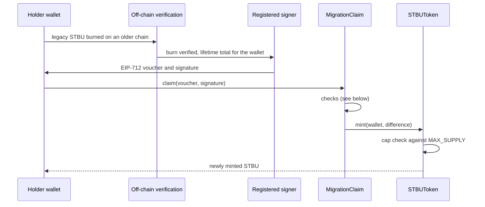

# Architecture

How the two contracts work and why they are built this way. Everything below is read from `src/STBUToken.sol` and `src/MigrationClaim.sol`; where a statement depends on how the contracts were deployed, it says so.

## Components

| Contract | Inherits | Role |
|---|---|---|
| `STBUToken` | OpenZeppelin `ERC20`, `ERC20Burnable`, `ERC20Pausable`, `ERC20Permit`, `AccessControl` | The canonical token. 18 decimals, name "Stobox Token", symbol "STBU". |
| `MigrationClaim` | OpenZeppelin `AccessControl`, `Pausable`, `ReentrancyGuard`, `EIP712` | The only intended minter. Turns signed vouchers into minted STBU. |

Both are immutable: no proxy, no upgrade hook. `MigrationClaim` holds the token as an `immutable` set in its constructor.

## The claim flow



Burn verification happens off chain. The contracts cannot see the legacy chains; they only check what they can check themselves.

## Cumulative vouchers

A voucher states the wallet's **lifetime** claimable total, not a per-claim amount. `claim` mints `cumulativeAmount - claimed[wallet]`. A replayed or stale voucher therefore mints zero or reverts, and a later voucher for the same wallet simply carries a larger total.

```solidity
struct MigrationVoucher {
    address wallet;            // beneficiary; tokens always mint here, never to msg.sender
    uint256 cumulativeAmount;  // lifetime total (wei) this wallet may ever have claimed
    uint256 deadline;          // unix time after which the voucher is unusable
    uint256 nonce;             // strictly increasing per wallet, starting at 1
    uint256 chainId;           // must equal block.chainid
    uint16  version;           // must equal activeVoucherVersion
}
```

- EIP-712 type string: `MigrationVoucher(address wallet,uint256 cumulativeAmount,uint256 deadline,uint256 nonce,uint256 chainId,uint16 version)`.
- EIP-712 domain: name `STBU MigrationClaim`, version `1`, the chain id and the `MigrationClaim` address.
- `hashVoucher(voucher)` returns the digest that the signer signs and that off-chain tooling must reproduce byte for byte. `domainSeparator()` returns the domain in effect.
- `claim` can be called by anyone (a third party may pay the gas). The beneficiary is part of the signed payload, so a caller cannot redirect the mint.

## What `claim` checks, in order

| # | Check | Revert |
|---|---|---|
| 1 | No reentrancy, then not paused | OpenZeppelin `ReentrancyGuardReentrantCall`, `EnforcedPause` |
| 2 | `block.timestamp >= claimStart` | `ClaimNotStarted(startsAt)` |
| 3 | `voucher.chainId == block.chainid` | `WrongChain(expected, actual)` |
| 4 | `voucher.version == activeVoucherVersion` | `StaleVoucherVersion(expected, actual)` |
| 5 | `block.timestamp <= voucher.deadline` | `VoucherExpired(deadline)` |
| 6 | Recovered signer is registered in `isSigner` | `InvalidSigner(recovered)` |
| 7 | `voucher.nonce > lastNonceOf(wallet)` | `NonceUsed(provided, lastAccepted)` |
| 8 | `voucher.cumulativeAmount > claimedOf(wallet)` | `NothingToClaim(cumulative, alreadyClaimed)` |

After the checks the contract updates `claimed`, `lastNonce` and `totalClaimed`, then calls `token.mint`. State is written before the external call, and the only external call is to the token. The token then rejects any mint that would pass the cap:

```solidity
if (amount > MAX_SUPPLY - supply) revert CapExceeded(amount, MAX_SUPPLY - supply);
```

## Roles

| Contract | Role | Held by | Can do |
|---|---|---|---|
| `STBUToken` | `DEFAULT_ADMIN_ROLE` | `initialAdmin` from the constructor (a multisig in production) | Grant and revoke any role on the token; `unpause()` |
| `STBUToken` | `CLAIM_ROLE` | Granted after deployment to `MigrationClaim` | `mint(to, amount)`, the only mint path |
| `STBUToken` | `PAUSER_ROLE` | Not set in the constructor; granted by the admin | `pause()` |
| `MigrationClaim` | `DEFAULT_ADMIN_ROLE` | `initialAdmin` from the constructor (a multisig in production) | `setSigner`, `setActiveVoucherVersion`, `setClaimStart`, `unpause()` |
| `MigrationClaim` | `PAUSER_ROLE` | `initialPauser` from the constructor | `pause()` |

Unpausing is deliberately limited to the admin, so a compromised pauser key cannot switch a halted system back on. Who currently holds each role is an on-chain fact: read it with `hasRole` ([OPERATIONS.md](OPERATIONS.md)).

## What can and cannot change

| Fixed in code | Adjustable by the admin |
|---|---|
| `MAX_SUPPLY` = 250,000,000e18, a constant | Registered signers (`setSigner`), several may be active during a rotation |
| The mint path: `mint` behind `CLAIM_ROLE` | Accepted voucher version (`setActiveVoucherVersion`); raising it invalidates every voucher signed under an earlier version |
| Zero supply at deployment | Claim start, only while the current start has not passed and never into the past |
| No proxy, no owner-mint function, no cap setter | Pause state (`unpause`), and role grants on the token |

The token's admin can grant `CLAIM_ROLE` to another address. This is the documented path for replacing a claim contract: the old one is paused and stripped of the role first, and the new one is deployed with a `predecessor` pointer. Whichever address mints, the cap check in `mint` still applies.

## Predecessor accounting

`MigrationClaim` takes an optional `predecessor` (`address(0)` for a first deployment). For a wallet that has no local state, `claimedOf` and `lastNonceOf` read the predecessor's values, so a replacement contract cannot mint again what the old one already minted. The contract deployed at the address in the [README](../README.md) has no predecessor (its `predecessor()` returns the zero address on 2026-10-16).

## Trust model

- The signer attests off-chain burn verification. The contracts cannot check legacy-chain burns, so the signer's honesty is a trust assumption.
- Every rule the claim contract can check by itself (replay, ordering, deadline, chain, version, claim window, pause) is checked regardless of the signer, and the token enforces the cap independently. A signer that signs an amount above what can be minted still cannot push total supply past 250,000,000 STBU.
- The `MigrationClaim` NatSpec describes the signer as a KMS-held key. The comment is part of the BaseScan-verified source, so it is left as it is.

TODO(owner): confirm that the key-management provider named in that NatSpec comment is current before anyone quotes it.

## Events

| Contract | Event | Emitted when |
|---|---|---|
| `STBUToken` | `Minted(to, amount, newTotalSupply)` | Every mint, next to `Transfer` |
| `STBUToken` | `MigrationBurn(from, amount)` | Every burn on Base (any transfer to the zero address), next to `Transfer`. It is not the legacy-chain burn |
| `MigrationClaim` | `MigrationMint(wallet, minted, cumulativeTotal, nonce)` | Every successful claim |
| `MigrationClaim` | `SignerSet(signer, registered)` | A signer is registered or removed |
| `MigrationClaim` | `VoucherVersionSet(previousVersion, newVersion)` | The accepted voucher version changes |
| `MigrationClaim` | `ClaimStartSet(previousStart, newStart)` | The claim start is set or rescheduled |

## Views for integrators

`claimedOf(wallet)`, `lastNonceOf(wallet)`, `claimableFor(wallet, cumulativeAmount)` (no signature check), `totalClaimed()`, `isSigner(address)`, `claimStart()`, `activeVoucherVersion()`, `token()`, `predecessor()`, `hashVoucher(voucher)`, `domainSeparator()`, and `VOUCHER_TYPEHASH`.

Related: [README](../README.md) · [OPERATIONS.md](OPERATIONS.md)
